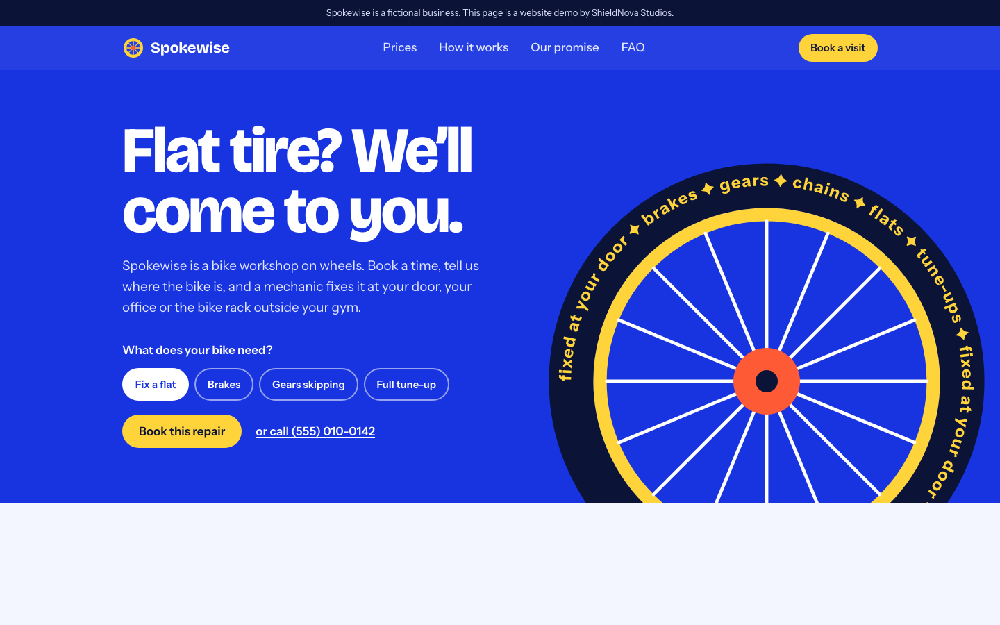
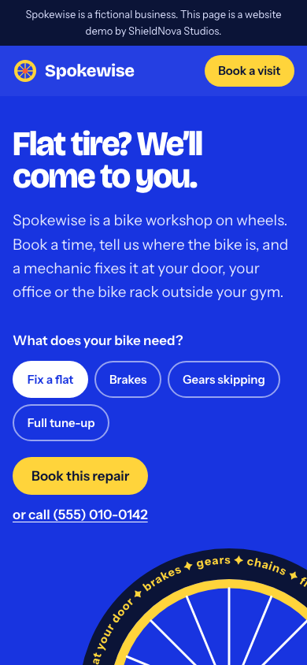

# Spokewise: small business landing page demo

A one-page website for **Spokewise**, a *fictional* mobile bike repair service.
It is a demo by **ShieldNova Studios** showing the kind of fast, accessible landing page we build
for small businesses with Claude Code.

Plain HTML, CSS and a little vanilla JavaScript. No framework, no build step, no trackers.
Open `index.html` in a browser and it works, even straight from your file system.

> **Live demo:** https://shieldnovastudios-labs.github.io/small-business-landing-page/
>
> To host your own copy on GitHub Pages: *Settings → Pages*, source **Deploy from a branch**, branch **main**,
> folder **/ (root)**. It appears at `https://<your-user>.github.io/<repo-name>/` within a minute or two.





## What's inside

| File | What it does |
|---|---|
| `index.html` | All page content and structure |
| `styles.css` | Design tokens (colors, fonts, spacing) and all styles, mobile first |
| `script.js` | Hero repair picker and booking form validation |
| `docs/` | Screenshots used in this README |

## Features

- **Hero with a working first step.** Visitors pick what their bike needs and the booking form opens with that repair already selected.
- **Price list** with sample prices clearly marked as a demo, plus duration per repair.
- **How it works** in three steps, drawn as a route.
- **What we promise** and an **FAQ** instead of testimonials. A demo business has no customers, so it shows no reviews: no invented quotes, ever.
- **Booking form** with client-side validation, inline error messages linked to each field (`aria-describedby`, `aria-invalid`), a summary announced to screen readers, and focus moved to the first problem.
- **Accessibility basics:** semantic landmarks, skip link, labelled fields, visible keyboard focus, WCAG AA color contrast, `prefers-reduced-motion` respected.
- **SEO and sharing:** meta description, Open Graph and Twitter card tags, inline SVG favicon (no image file).
- **One memorable visual:** a bicycle wheel drawn in SVG that rolls in once on load, with the services written around the tire. No stock photos, no downloaded images.

## Customize it in 2 minutes

1. **Colors.** Open `styles.css`. The first block (`:root`) holds every brand color:
   ```css
   --blue: #1834E0;   /* main brand color */
   --sun:  #FFD43B;   /* highlight */
   --tomato: #FF5A36; /* small accents */
   --ink:  #0B1437;   /* text */
   ```
   Change these and the whole page follows, including the wheel.
2. **Fonts.** Swap the Google Fonts link in `index.html` and the two `--font-*` variables in `styles.css`.
3. **Text.** Everything a visitor reads is in `index.html`, in order from top to bottom. Search for the business name, phone `(555) 010-0142`, `hello@example.com` and `123 Example Street` and replace them.
4. **Prices.** Each repair is one `<li class="price-row">` in the *Repairs and prices* section. Copy a row to add a service. Remove the "Sample prices" note once the prices are real.
5. **Social preview.** Update `og:title`, `og:description` and `og:image` in the `<head>`. Use an absolute URL for `og:image` once the site has a domain.

## Connect the form

The form currently has a placeholder `action="#"`, so it validates and shows a success message without sending anything.
Pick one service and change the `<form id="booking-form">` tag:

**Formspree** (works on GitHub Pages or any host)
1. Create a form at formspree.io and copy its endpoint.
2. Set the form tag to:
   ```html
   <form class="booking" id="booking-form" action="https://formspree.io/f/YOUR_ID" method="post" novalidate>
   ```
3. Submissions arrive by email. Validation still runs first; once the action is no longer `#`, the demo message is skipped and the form posts normally.

**Netlify Forms** (when the site is hosted on Netlify)
1. Add `name="booking" data-netlify="true"` to the form tag and set `action="/thanks.html"` (create a simple thank-you page).
2. Add a hidden field inside the form: `<input type="hidden" name="form-name" value="booking">`.
3. Deploy. Netlify detects the form and lists submissions in its dashboard.

Either way, add a spam filter the service offers (honeypot field or reCAPTCHA) before going live.

## Privacy note

The page loads two typefaces from Google Fonts. Everything else is local. To serve fonts from your own host instead
(stricter for GDPR), download the font files, place them in a `fonts/` folder, replace the Google Fonts `<link>` with
`@font-face` rules, and delete the two `preconnect` lines.

## License

MIT. See [LICENSE](LICENSE). Spokewise, its address, phone number and prices are fictional placeholders.
